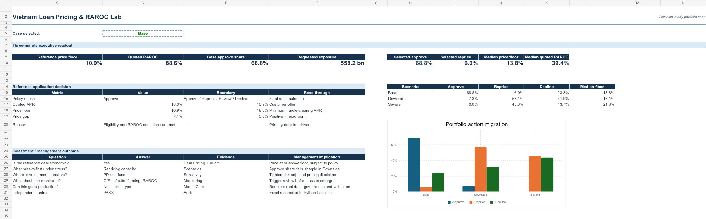
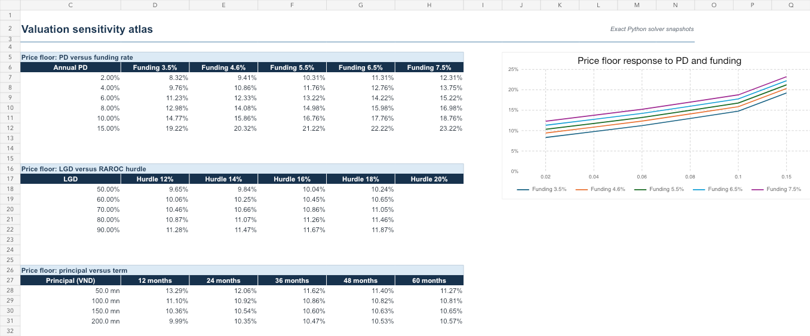

# Vietnam Loan Pricing & RAROC Lab

[](https://github.com/thvh2006/vietnam-loan-pricing-raroc-lab/actions/workflows/ci.yml)
[](pyproject.toml)
[](reports/Vietnam_Loan_Pricing_RAROC_Workbook.xlsx)

An auditable decision case for pricing unsecured personal instalment loans in Vietnam. The project connects underwriting risk to a quoted annual rate, capital consumption, risk-adjusted return and a controlled credit action.

The central question is:

> Can a lender convert PD, LGD, exposure, funding cost and capital constraints into a price and policy that remain economically defensible under stress?



The first screen gives the decision, economics, scenario migration and management implication without requiring the reviewer to inspect formulas. The underlying workbook then opens each result into cash-flow, capital, solver, sensitivity and audit evidence.

## Current decision scope

- Product: unsecured personal instalment loan in VND.
- Decision point: application-time offer pricing.
- Primary actions: approve, reprice, manual review or decline.
- Capital view: standardized retail regulatory proxy, economic-capital proxy and an editable management floor.
- Status: research, policy engine, scenario lab, formula-driven decision workbook and model controls complete; an interactive web dashboard is the next release layer.

This is a portfolio case study, not a lending offer, regulatory filing or production credit policy. Applicant records generated by the repository are synthetic. Public sources are used only for market and regulatory benchmarks.

## Decision flow

```text
application + underwriting PD
              |
              v
eligibility and affordability gates
              |
              v
cash-flow and expected-loss schedule
              |
              +--> regulatory capital proxy
              +--> economic capital proxy
              +--> management capital floor
              |
              v
minimum rate for target RAROC
              |
              v
approve / reprice / review / decline
```

## Core equations

For month `t`, the engine builds contractual amortisation and survival-weighted economics:

```text
Monthly hazard       = 1 - (1 - annual PD)^(1/12)
Marginal default_t   = survival at start_t x monthly hazard
Expected loss_t      = marginal default_t x EAD at default_t x LGD
Funding cost_t       = performing opening balance_t x funding rate / 12
```

Capital views are kept separate:

```text
Regulatory capital   = average performing EAD x retail risk weight x capital ratio
Economic capital     = average performing EAD x stressed loss-rate gap
Allocated capital    = max(regulatory capital, economic capital, management floor)
RAROC                = annualised after-tax risk-adjusted profit / allocated capital
```

The break-even contractual rate is solved numerically so that RAROC meets the selected hurdle rate. The engine does not use the quoted customer rate as its own hurdle input.

## Repository map

| Path | Purpose |
| --- | --- |
| `src/raroc_lab/engine.py` | Amortisation, expected loss, capital and rate solver |
| `src/raroc_lab/policy.py` | Eligibility and approve/reprice/review/decline rules |
| `configs/base_case.json` | Editable economic and policy assumptions |
| `data/sample_applications.csv` | Small transparent synthetic fixture |
| `scripts/run_portfolio.py` | Deterministic portfolio simulation and report build |
| `reports/` | Generated application and portfolio decision tables |
| `reports/Vietnam_Loan_Pricing_RAROC_Workbook.xlsx` | Formula-driven pricing schedule, capital views and sensitivities |
| `reports/scenario_summary.json` | Base, Downside and Severe decision migration |
| `reports/segment_summary.csv` | Portfolio cuts by principal, risk tier and term |
| `reports/monitoring_sample.csv` | Illustrative monthly monitoring and trigger data |
| `MODEL_CARD.md` | Intended use, limitations, validation evidence and production path |
| `docs/model_charter.md` | Intended use, prohibited use and governance |
| `docs/research_synthesis.md` | Regulatory and market evidence with claim boundaries |
| `docs/validation_report.md` | Automated controls, reconciliation evidence and production validation backlog |
| `tests/` | Formula, monotonicity and policy boundary tests |

## Reproduce

```bash
python -m scripts.run_portfolio
python -m scripts.build_sensitivity
python -m scripts.build_extended_reports
python -m unittest discover -s tests -v
```

The engine uses only the Python standard library. Generated reports are deterministic for the configured random seed.

The continuous-integration workflow tests Python 3.11 and 3.12, rebuilds the evidence pack and fails when committed reports are no longer reproducible.

## Workbook experience

The Excel deliverable contains 13 linked sheets:

1. `Executive Summary` — three-minute management readout and investment outcome.
2. `Deal Pricing` — editable reference application and controlled policy action.
3. `Assumptions` — one authoritative Base/Downside/Severe selector.
4. `Cash Flow` — 60-month contractual and survival-weighted economics.
5. `Price Build` — funding, liquidity, operations, expected loss, capital, tax and fee bridge.
6. `Scenarios` — portfolio decision migration and stressed economics.
7. `Sensitivity` — PD/funding, LGD/hurdle and principal/term matrices.
8. `Portfolio Summary` — segment cuts by exposure, risk and decision outcome.
9. `Monitoring` — monthly KPIs, triggers and ownership.
10. `Portfolio Data` — all 4,000 application-level decisions.
11. `Rate Solver` — 231 APR candidates from 7% to 30% in 10 bp steps.
12. `Audit` — Excel-to-Python reconciliation and independent controls.
13. `Sources & Notes` — source registry, refresh workflow and limitations.

Yellow and blue-font cells are user-controlled inputs. Green-font cells are calculated outputs. The selected scenario flows through the live deal model and solver; portfolio scenario tables remain governed engine snapshots.



## Base-case portfolio result

The deterministic 4,000-application synthetic book requests VND 558.2 billion. Under the current policy and pricing assumptions:

- 68.8% approve;
- 6.0% require repricing;
- 23.8% decline, principally through risk or affordability gates;
- 1.4% route to manual review;
- the median feasible price floor is 13.80%, with an interquartile range of 11.13% to 17.65%.

These percentages describe the synthetic test population and must not be presented as Vietnamese market approval rates.

## Evidence boundary

- The 75% standardized retail risk weight is a regulatory benchmark, not a statement that every exposure qualifies.
- The capital ratio and management buffer are configurable decision assumptions.
- The economic-capital calculation is a portfolio proxy and is not represented as an approved internal-model capital calculation.
- Public bank-wide funding and return metrics are context, not product-level unit economics.
- Synthetic applications support reproducibility and policy testing; they do not establish market approval rates or borrower behaviour.
